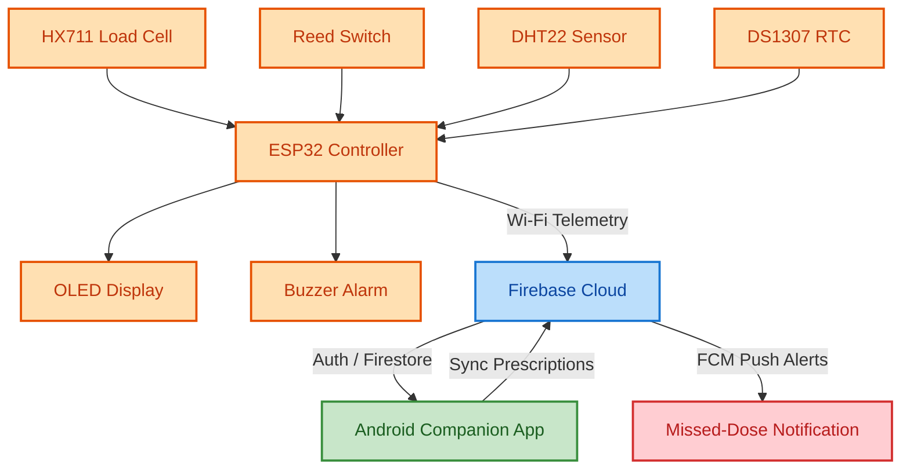
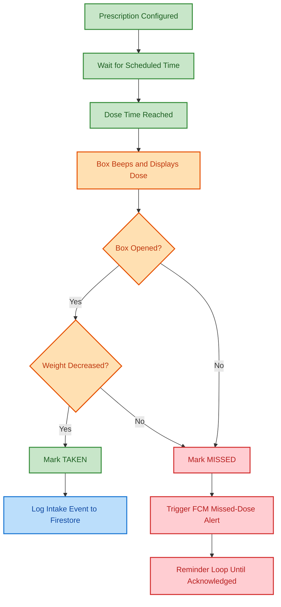
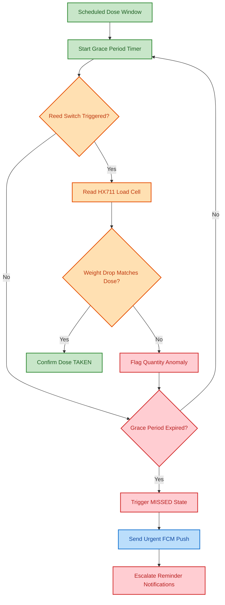
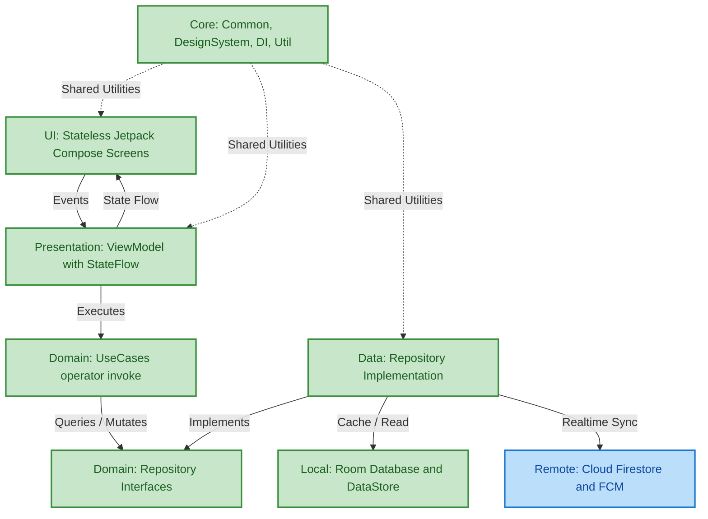
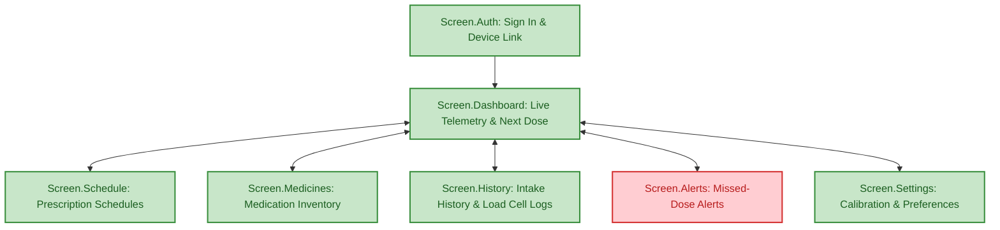
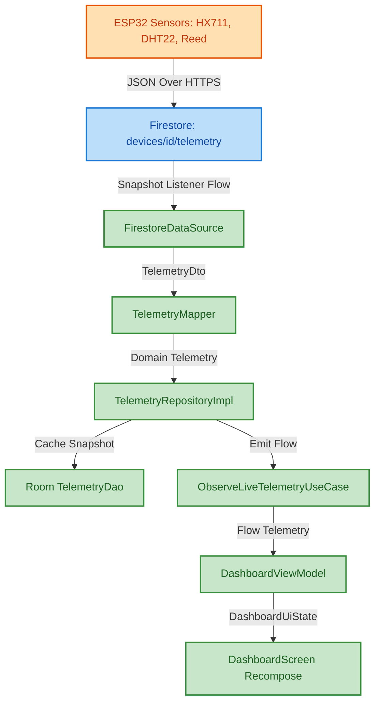
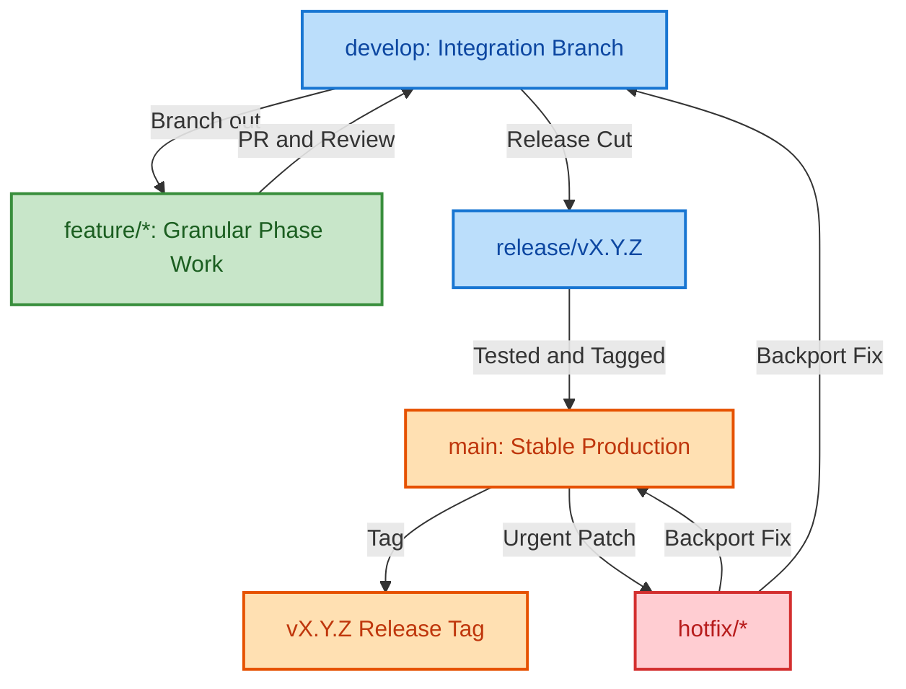
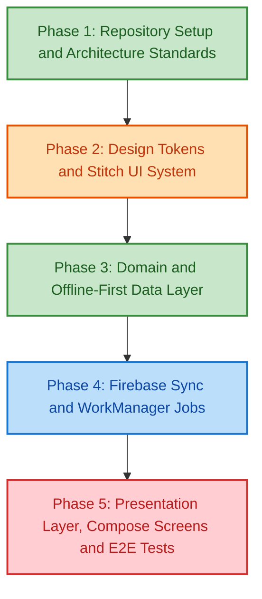

# Smart Medicine Box

> IoT-enabled companion Android app for automated medication scheduling, real-time load-cell weight telemetry, and proactive adherence alerts.

---

### System Overview

---

### Dose Lifecycle

---

### Missed-Dose Detection Logic

---

### App Architecture Layers

---

### App Navigation Map

---

### Real-Time Telemetry Data Flow

---

### Git Branching & Release Workflow

---

### Project Roadmap by Phase

---

### Tech Stack

- **Core & UI**: Kotlin 2.1.0, Jetpack Compose, Material 3, Navigation Compose.
- **Architecture & DI**: MVVM, Clean Architecture (UDF), Dagger Hilt, Coroutines & StateFlow.
- **Data & Backend**: Room Database, Preferences DataStore, Cloud Firestore, Firebase Auth & FCM.
- **Build & Quality**: Gradle Kotlin DSL with Version Catalog (`libs.versions.toml`), WorkManager.

---

### Getting Started

- Open project in Android Studio (Ladybug or newer) with JDK 17+.
- Add `google-services.json` to the `app/` directory (obtain from Firebase console).
- Configure Stitch MCP server in Antigravity or provide API credentials for design tokens.
- Run `./gradlew test` for unit tests or `./gradlew assembleDebug` to build the APK.
