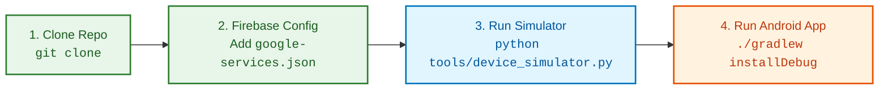
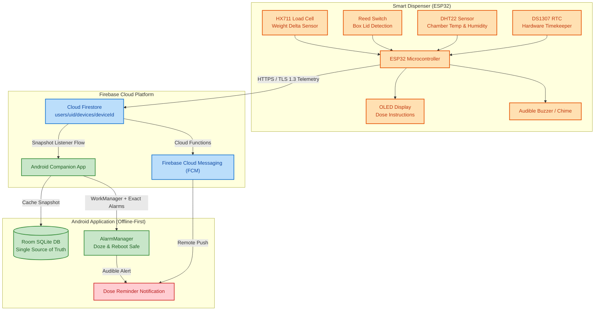
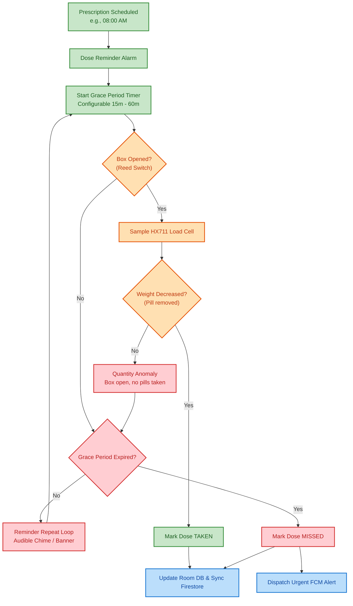
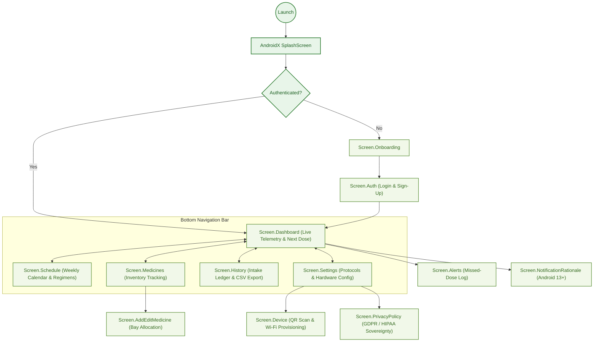
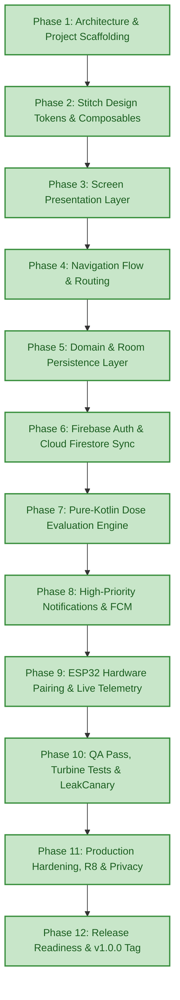

# Smart Medicine Box

> IoT-enabled companion Android app for automated medication scheduling, real-time load-cell weight telemetry, and proactive adherence alerts.

[](https://kotlinlang.org)
[](https://developer.android.com)
[](https://developer.android.com/jetpack/compose)
[](app/build/reports/tests/testDebugUnitTest/index.html)
[](https://firebase.google.com)
[](LICENSE)

---

## Quick Setup & Developer Getting Started



### Setup Instructions

1. **Clone the repository**:
   ```bash
   git clone https://github.com/AdityaSurse/Smart-Medicine-Box.git
   cd Smart-Medicine-Box
   ```
2. **Add Firebase configuration**:
   - Download `google-services.json` from your Firebase Console project.
   - Place `google-services.json` into the `app/` folder:
     ```bash
     cp /path/to/downloaded/google-services.json app/
     ```
3. **Launch the Hardware Device Simulator**:
   - If physical ESP32 hardware is not connected, use the provided Python simulator:
     ```bash
     cd tools
     pip install firebase-admin
     python device_simulator.py --device-id DG_BOX_4081
     ```
   - The simulator emits realistic load cell weight deltas, reed switch open/close events, and DHT22 temperature/humidity readings directly to Firestore.
4. **Compile & Run the Android App**:
   - Open in **Android Studio (Ladybug 2024.2+ or newer)** with JDK 21.
   - Run tests: `./gradlew testDebugUnitTest`
   - Install debug build: `./gradlew installDebug`

---

## System Overview & Hardware Architecture



---

## Dose Evaluation Engine

The physical medication intake lifecycle is verified using a pure-Kotlin deterministic engine:



---

## App Navigation & Architecture Map



---

## App Screens & UI Gallery

The UI was crafted from Figma designs via the Stitch MCP with an apothecary aesthetic:

| 📱 Live Telemetry Dashboard | ⏰ Schedule & Regimens | 💊 Medicines Inventory | 📋 Clinical History |
| :---: | :---: | :---: | :---: |
| <br/>*Real-time weight, temp, humidity & countdown* | <br/>*Weekly calendar strip with active dosage times* | <br/>*Inventory stocks, pill pill-count & bay assignments* | <br/>*Intake ledger with clinical adherence scores* |

| 🚨 Alerts & Emergency Warnings | 🎛️ QR Device Pairing | ⚙️ Clinical Settings & Export | 🛡️ Patient Privacy Policy |
| :---: | :---: | :---: | :---: |
| <br/>*Missed dose logs & environmental threshold alerts* | <br/>*Camera QR scanning & Wi-Fi provisioning* | <br/>*Grace period, quiet hours & CSV/PDF exporter* | <br/>*GDPR/HIPAA data sovereignty & wipe options* |

---

## Technology Stack

- **Language & Runtime**: Kotlin 2.1.0 (Strict null safety, Coroutines, Flow).
- **UI Toolkit**: Jetpack Compose with Material 3 (UDF architecture, stateless screens, zero hardcoded dimensions).
- **Dependency Injection**: Dagger Hilt 2.51 (`@HiltAndroidApp`, `@HiltViewModel`, `@AndroidEntryPoint`).
- **Persistence & Offline-First**:
  - **Room SQLite Database**: Offline cache for medicines, schedules, intake logs, and device status.
  - **Preferences DataStore**: User configurations, snooze intervals, and measurement units.
- **Cloud Infrastructure**:
  - **Firebase Authentication**: Email/Password and Google Sign-In.
  - **Cloud Firestore**: Real-time sync with user-scoped security boundaries (`firestore.rules`).
  - **Firebase Cloud Messaging (FCM)**: Push notifications for missed doses and chamber anomalies.
- **Background Tasks & Alarms**: Jetpack WorkManager 2.10 + `AlarmManager.setExactAndAllowWhileIdle()`.
- **Quality & Profiling**:
  - **Testing**: JUnit 4, MockK, `kotlinx-coroutines-test`, `Turbine` (155 automated unit tests passing).
  - **Static Analysis**: KtLint 12.1 + Detekt 1.23.8 (0 violations).
  - **Memory Safety**: Square LeakCanary 2.14 + Android StrictMode in debug builds.
  - **Release Optimization**: R8 minification, bytecode obfuscation, and resource shrinking.

---

## Project Roadmap (Phases 1–12 Completed)



---

## Technical Documentation Index

Detailed specifications and architectural guides are maintained in the [`docs/`](docs/README.md) directory:

- 📑 **[Documentation Index (`docs/README.md`)](docs/README.md)**: Master directory and summaries.
- 📡 **[Cloud Data Contract (`docs/DATA_CONTRACT.md`)](docs/DATA_CONTRACT.md)**: Shared ESP32 firmware & Android Firestore schemas.
- 📶 **[Wi-Fi Provisioning Protocol (`docs/PROVISIONING.md`)](docs/PROVISIONING.md)**: SoftAP and BLE provisioning handshake and security schemes.
- 🧪 **[QA & Verification Audit (`docs/QA_REPORT.md`)](docs/QA_REPORT.md)**: Formal testing audit, coverage analysis, and accessibility results.
- 📜 **[Changelog (`CHANGELOG.md`)](CHANGELOG.md)**: Version release notes and commit history.
