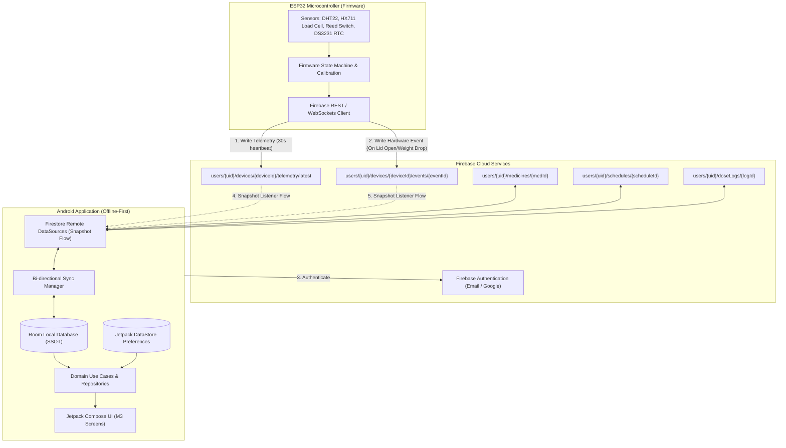

# Data Contract & Firestore Schema Specification: Smart Medicine Box

> **Version**: 1.0.0  
> **Target Platforms**: ESP32 Firmware (FreeRTOS / C++ / Arduino), Android Client (Jetpack Compose / Kotlin Clean Architecture), Cloud Firestore  
> **Security Model**: User-scoped document partitioning (`users/{uid}/...`) with strict role-based Firestore Rules.

---

## 1. System Architecture & End-to-End Flowchart

The Smart Medicine Box ecosystem comprises three interconnected tiers:
1. **Physical Embedded Tier (ESP32)**: Reads hardware peripherals (DHT22 temperature/humidity, HX711 4-wire load cell strain gauge, reed switch lid sensor, DS3231 real-time clock) and publishes real-time telemetry and discrete hardware events.
2. **Cloud Tier (Google Cloud Firestore & Firebase Auth)**: Acts as the real-time synchronization transport and persistent remote storage.
3. **Mobile Client Tier (Android MVVM + Room Offline-First)**: Employs Snapshot Listeners mapped to Kotlin `Flow`s, caching everything into local SQLite via Room as the Single Source of Truth (SSOT).



---

## 2. Firestore Document Paths & Schemas

All collections are scoped under the authenticated user's ID (`users/{uid}/...`). This ensures zero cross-tenant contamination and aligns directly with Firebase Security Rules.

### 2.1 Device Metadata
- **Path**: `users/{uid}/devices/{deviceId}`
- **Purpose**: Tracks paired hardware box specifications, registration date, network address, and pairing status.

| Field Name | Type | Constraints / Format | Description |
| :--- | :--- | :--- | :--- |
| `deviceId` | `string` | e.g. `"DG-4081"` | Hardware Serial Number / Unique Identifier |
| `modelName` | `string` | e.g. `"DoseGuard Bay 4X"` | Commercial product model string |
| `serialNumber` | `string` | e.g. `"#DG-4081-B"` | Manufacturer production serial |
| `firmwareVersion`| `string` | Semantic version (e.g. `"v2.4.1"`) | Embedded firmware build tag |
| `hardwareRev` | `string` | e.g. `"Rev 3.2"` | PCB / circuit revision identifier |
| `macAddress` | `string` | `XX:XX:XX:XX:XX:XX` | ESP32 Wi-Fi / BLE MAC address |
| `baysCount` | `integer`| Min: `1`, Max: `8` (Default `4`) | Number of monitored physical trays |
| `isOnline` | `boolean`| `true` / `false` | Heartbeat presence flag |
| `batteryPercent`| `integer`| Range: `0` to `100` | Last reported battery level |
| `wifiSsid` | `string` | e.g. `"Apothecary_Guest_5G"`| Connected wireless access point |
| `ipAddress` | `string` | IPv4 format | Local LAN IP for debugging / mDNS |
| `lastSeen` | `timestamp`| Firestore server timestamp | Heartbeat timestamp |
| `pairedAt` | `timestamp`| Client/server timestamp | Registration / pairing time |

**Example Document JSON**:
```json
{
  "deviceId": "DG-4081",
  "modelName": "DoseGuard Bay 4X",
  "serialNumber": "#DG-4081-B",
  "firmwareVersion": "v2.4.1",
  "hardwareRev": "Rev 3.2",
  "macAddress": "24:6F:28:AB:D4:C2",
  "baysCount": 4,
  "isOnline": true,
  "batteryPercent": 84,
  "wifiSsid": "Home_WiFi_2G",
  "ipAddress": "192.168.1.142",
  "lastSeen": "2026-10-29T15:30:00Z",
  "pairedAt": "2026-10-01T10:00:00Z"
}
```

---

### 2.2 Live Telemetry (`latest`)
- **Path**: `users/{uid}/devices/{deviceId}/telemetry/latest`
- **Purpose**: Fixed singleton document overwritten by the ESP32 every 30 seconds or immediately upon environment changes. Provides instantaneous dashboard vitals without accumulating unneeded document billing overhead.

| Field Name | Type | Units / Range | Description |
| :--- | :--- | :--- | :--- |
| `temp` | `number` | Celsius (`-10.0` to `60.0`) | DHT22 chamber temperature |
| `humidity` | `number` | Percent (`0.0` to `100.0`) | DHT22 relative ambient humidity |
| `weightGrams`| `number` | Grams (`0.0` to `5000.0`) | HX711 calibrated load cell reading |
| `boxOpen` | `boolean`| `true` (open), `false` (shut)| Magnetic reed switch state |
| `rtcTime` | `string` | ISO 8601 (`YYYY-MM-DDTHH:mm:ss`)| DS3231 battery-backed hardware clock |
| `ts` | `timestamp`| Server Timestamp | Epoch timestamp when telemetry was processed |
| `batteryPercent`| `integer`| `0` to `100` | Battery voltage percentage from ADC |
| `wifiRssi` | `integer`| dBm (`-100` to `0`) | Wi-Fi link signal strength |

**Example Document JSON**:
```json
{
  "temp": 21.4,
  "humidity": 46.0,
  "weightGrams": 14.8,
  "boxOpen": false,
  "rtcTime": "2026-10-29T15:30:00Z",
  "ts": "2026-10-29T15:30:02Z",
  "batteryPercent": 84,
  "wifiRssi": -62
}
```

---

### 2.3 Hardware Event Stream
- **Path**: `users/{uid}/devices/{deviceId}/events/{eventId}`
- **Purpose**: Append-only log of physical interactions triggered by firmware interrupts (lid opening, pill weight drop, chamber tamper).

| Field Name | Type | Valid Values | Description |
| :--- | :--- | :--- | :--- |
| `eventId` | `string` | UUID or `evt_{ts}` | Unique event transaction ID |
| `eventType` | `string` | `BOX_OPENED`, `BOX_CLOSED`, `WEIGHT_DROP`, `WEIGHT_INCREASE`, `TAMPER_ALERT`, `LOW_BATTERY` | Discrete hardware state change |
| `timestamp` | `timestamp`| Firestore server timestamp | Event occurrence timestamp |
| `rtcTime` | `string` | ISO 8601 string | Local hardware RTC reading |
| `deltaWeightGrams`| `number` | Float (e.g. `-0.55`) | Difference compared to previous stable weight |
| `currentWeightGrams`|`number`| Float (e.g. `14.25`) | Resulting total load cell reading |
| `trayBay` | `string` | e.g. `"Bay 01"`, `"Bay 02"` | Associated compartment if localized |
| `details` | `string` | Human-readable note | Context (e.g. `"Lid opened for 14 seconds"`) |

**Example Document JSON**:
```json
{
  "eventId": "evt_1729000120000",
  "eventType": "WEIGHT_DROP",
  "timestamp": "2026-10-29T15:32:00Z",
  "rtcTime": "2026-10-29T15:32:00Z",
  "deltaWeightGrams": -0.55,
  "currentWeightGrams": 14.25,
  "trayBay": "Bay 01",
  "details": "Pill extraction confirmed via HX711 sensor"
}
```

---

### 2.4 Medicines Collection
- **Path**: `users/{uid}/medicines/{medicineId}`
- **Purpose**: Defines pharmaceutical metadata, physical compartment assignment, inventory limits, and unit pill weights.

| Field Name | Type | Description |
| :--- | :--- | :--- |
| `id` | `string` | Unique medicine ID (e.g. `"med_amox"`) |
| `name` | `string` | Brand or generic name (e.g. `"Amoxicillin"`) |
| `dosageDescription` | `string` | Dosage instructions (e.g. `"500 mg • Antibiotic capsule"`) |
| `strengthMg` | `integer` | Active ingredient strength in milligrams |
| `formFactor` | `string` | Capsule, Tablet, Coated Pill, Softgel |
| `compartmentIndex` | `integer` | Physical tray index (1 to 4) |
| `compartmentLabel` | `string` | UI label (e.g. `"Bay 01"`) |
| `timings` | `array<string>` | Dispense timings (e.g. `["08:00 AM", "08:00 PM"]`) |
| `repeatDays` | `array<string>` | Weekdays scheduled (e.g. `["M", "T", "W", "T", "F"]`) |
| `currentStock` | `integer` | Current remaining pill count |
| `totalStock` | `integer` | Container total supply capacity |
| `lowStockThreshold`| `integer` | Warning trigger limit (e.g. `5`) |
| `estimatedUnitWeightGrams` | `number` | Expected single unit weight for tare calculation |
| `isActive` | `boolean` | Course active status |
| `updatedAt` | `timestamp` | Last synchronized modification timestamp |
| `createdAt` | `timestamp` | Record creation timestamp |

---

### 2.5 Dose Schedules Collection
- **Path**: `users/{uid}/schedules/{scheduleId}`
- **Purpose**: Configures active alarm times, allowable grace periods, and weekdays for each prescription.

| Field Name | Type | Description |
| :--- | :--- | :--- |
| `id` | `string` | Unique schedule ID (e.g. `"sch_amox"`) |
| `medicineId` | `string` | Foreign key referencing `users/{uid}/medicines/{id}` |
| `medicineName` | `string` | Denormalized medicine name for offline display |
| `times` | `array<string>` | Formatted alarm times (`["08:00 AM", "08:00 PM"]`) |
| `daysOfWeek` | `array<integer>` | Days active (1 = Monday, ..., 7 = Sunday) |
| `gracePeriodMinutes` | `integer` | Window before marking dose as MISSED (e.g. `30`) |
| `compartmentBay` | `string` | Bay label (e.g. `"Bay 01"`) |
| `isActive` | `boolean` | Schedule toggle switch |
| `updatedAt` | `timestamp` | Last updated timestamp |

---

### 2.6 Dose Intake Logs Collection
- **Path**: `users/{uid}/doseLogs/{logId}`
- **Purpose**: Audit trail of every scheduled dose instance and whether it was taken, pending, or missed.

| Field Name | Type | Description |
| :--- | :--- | :--- |
| `id` | `string` | Unique log entry ID |
| `scheduleId` | `string` | Associated schedule ID |
| `medicineId` | `string` | Associated medicine ID |
| `medicineName` | `string` | Medicine title |
| `dosage` | `string` | Dose instructions (e.g. `"500 mg • 1 capsule"`) |
| `scheduledTimeEpochMillis` | `integer` | Scheduled target timestamp (ms) |
| `status` | `string` | Status: `TAKEN`, `PENDING`, `MISSED` |
| `loggedTimeEpochMillis` | `integer?` | Actual intake timestamp (ms) |
| `recordedWeightGrams` | `number?` | Weight delta detected during dose |
| `bayLabel` | `string` | Associated tray (e.g. `"Tray 01"`) |
| `source` | `string` | `DEVICE_SENSOR` (HX711/reed) or `MANUAL_APP` |
| `updatedAt` | `timestamp` | Sync modification timestamp |

---

## 3. ESP32 Firmware Implementation Contract

### 3.1 Initialization Sequence
1. **Boot & Calibration**:
   - Power on peripherals (DHT22, HX711, DS3231).
   - Read HX711 tare baseline from non-volatile storage (NVS) if previously zeroed.
   - Synchronize RTC with NTP server when Wi-Fi is connected.
2. **Authentication**:
   - ESP32 stores an API Key or Firebase Auth Custom Token / Device Credential in secure NVS.
   - Token refresh executed automatically prior to expiration.
3. **Heartbeat Loop (30-second cadence)**:
   - Read DHT22 temperature and humidity.
   - Read stable average from HX711 (5-sample median filter).
   - Check reed switch GPIO interrupt state.
   - HTTP/REST `PATCH` or WebSocket write to `users/{uid}/devices/{deviceId}/telemetry/latest`.
4. **Hardware Interrupt Handler (Immediate execution)**:
   - On reed switch trigger (`GPIO falling/rising`):
     - Immediately record RTC timestamp.
     - Sample load cell before opening and after closing.
     - Compute `deltaWeightGrams = weight_closed - weight_opened`.
     - Append document to `users/{uid}/devices/{deviceId}/events/{eventId}` with `eventType = "BOX_OPENED"` or `"WEIGHT_DROP"`.

---

## 4. Offline Synchronization & Conflict Resolution

- **Room as Single Source of Truth**: Mobile UI composables observe Room DAOs via Kotlin `Flow`. The UI never binds directly to Firestore network calls.
- **Snapshot Listener Hydration**: Snapshot listeners on Firestore collections update the Room database in the background. If new documents arrive from the ESP32, Room is upserted, and the UI reacts reactively.
- **Last-Write-Wins (LWW)**: Updates carry an `updatedAt` epoch timestamp. When reconciling discrepancies, the latest timestamp takes precedence.
- **Optimistic Local Updates**: When a user creates a medicine or logs a dose on the Android app, Room writes the entity synchronously, guaranteeing immediate UI feedback. The Firestore sync worker subsequently pushes the payload to the cloud when connectivity is established.
