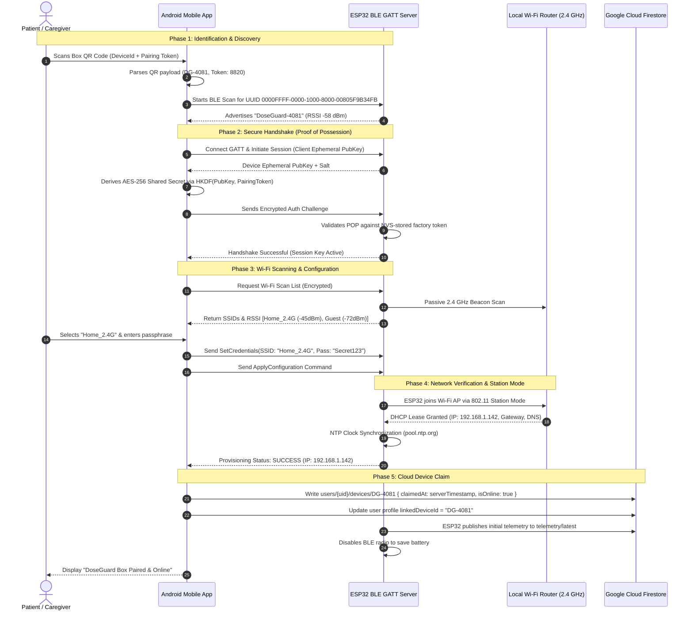

# ESP32 Wi-Fi Provisioning Architecture & Implementation Specification

> **Target Platform**: ESP32-WROOM-32 / ESP32-S3 (FreeRTOS, ESP-IDF v5.x / Arduino-ESP32)  
> **Mobile Client**: Android (Kotlin, Jetpack Compose, Coroutines Flow)  
> **Security Model**: Curve25519 Key Exchange / AES-256-GCM authenticated encryption with Proof of Possession (POP).

---

## 1. System Overview

When a patient or caregiver unpacks a new **Smart Medicine Box (DoseGuard)**, the device does not yet possess local Wi-Fi credentials to communicate with Cloud Firestore. The provisioning flow securely establishes connectivity between the Android mobile application and the ESP32 hardware to:

1. Discover and identify the unconfigured box.
2. Authenticate the box using a unique factory-printed Pairing Token (Proof of Possession).
3. Transmit local Wi-Fi network credentials (SSID and passphrase) via an encrypted peer-to-peer transport.
4. Verify the ESP32 connects successfully to the Wi-Fi Access Point and obtains a valid IP address.
5. Claim the hardware serial number to the authenticated user's account in Cloud Firestore (`users/{uid}/devices/{deviceId}`).

---

## 2. Transport Architecture: BLE vs. SoftAP

The system supports two complementary provisioning transports:

| Metric | Option A: BLE Provisioning (`esp_wifi_prov` via GATT) | Option B: SoftAP Provisioning (Captive Portal / HTTP) |
| :--- | :--- | :--- |
| **Primary Use** | **Default / Recommended** | **Fallback (Older devices or BLE disabled)** |
| **Protocol** | Bluetooth Low Energy GATT Services + Protobuf/JSON | ESP32 802.11 b/g/n SoftAP (`192.168.4.1`) + REST API |
| **User Experience** | Seamless background connection; zero Wi-Fi network switching | Requires user to connect phone Wi-Fi to `"DoseGuard-XXXX"` |
| **Android Permissions**| `BLUETOOTH_SCAN`, `BLUETOOTH_CONNECT` (Android 12+) | `CHANGE_NETWORK_STATE`, `ACCESS_FINE_LOCATION` |
| **Security** | Security Scheme 1 (Curve25519 + AES-GCM + POP) | WPA2 Pre-Shared Key + TLS 1.3 / HTTPS |
| **ESP32 Memory** | Medium (Bluetooth stack ~65 KB RAM) | Lower (Lightweight WebServer) |

---

## 3. End-to-End Sequence Diagram



---

## 4. Security Scheme & Proof of Possession (POP)

1. **Factory Pairing Token (POP)**:
   - Each hardware unit has a cryptographically random 4 to 8-character token (e.g., `8820` or `K9B3-7721`) burned into ESP32 `eFuse` / encrypted NVS during factory calibration.
   - The token is physically printed on the bottom label of the dispenser and encoded in the setup QR code.
2. **Ephemeral Key Exchange**:
   - Both Android app and ESP32 generate ephemeral Curve25519 keypairs.
   - Shared secret $S$ is derived via Diffie-Hellman: $S = \text{X25519}(d_{\text{app}}, Q_{\text{esp}})$.
   - Cryptographic session key $K_{\text{session}}$ is generated via HKDF-SHA256:
     $$K_{\text{session}} = \text{HKDF-Expand}(\text{HKDF-Extract}(\text{Salt}, S), \text{POP}, 32)$$
3. **Payload Confidentiality**:
   - All Wi-Fi credentials (SSID and WPA2/WPA3 passphrase) are encrypted using AES-256-GCM with a 96-bit random initialization vector (IV) per transmission.
   - Protects against eavesdropping on open radio frequencies during setup.

---

## 5. Fallback: SoftAP Provisioning Workflow

If Bluetooth is unavailable, damaged, or disabled by device policy:
1. The user presses and holds the dispenser setup button for 5 seconds.
2. ESP32 illuminates a solid amber LED and creates an open or WPA2 Wi-Fi Access Point:
   - **SSID**: `DoseGuard-Setup-DG4081`
   - **Gateway IP**: `192.168.4.1`
3. The Android app connects to this network using `WifiNetworkSpecifier` / `ConnectivityManager.requestNetwork()`.
4. The app exchanges JSON payloads over HTTP:
   - `GET http://192.168.4.1/api/scan`: Returns list of nearby visible 2.4 GHz SSIDs.
   - `POST http://192.168.4.1/api/configure`:
     ```json
     {
       "ssid": "Home_WiFi_2G",
       "passphrase": "WiFiPassword123",
       "pairingToken": "8820",
       "uid": "user_eleanor_8820"
     }
     ```
   - `GET http://192.168.4.1/api/status`: Polls status until `{"state": "CONNECTED", "ip": "192.168.1.142"}`.

---

## 6. Android Implementation Layer

The mobile application architecture decouples the provisioning mechanism behind a clean domain interface:

```kotlin
interface WifiProvisioner {
    fun observeProvisioningState(): Flow<ProvisioningState>
    suspend fun scanAvailableNetworks(): Result<List<WifiNetwork>>
    suspend fun provisionDevice(
        deviceId: String,
        pairingToken: String,
        ssid: String,
        passphrase: String
    ): Result<ProvisioningResult>
}
```

The domain layer remains completely unaware of whether the hardware is configured via ESP-IDF BLE GATT or SoftAP HTTP, adhering strictly to the Clean Architecture boundaries outlined in `AGENTS.md`.

