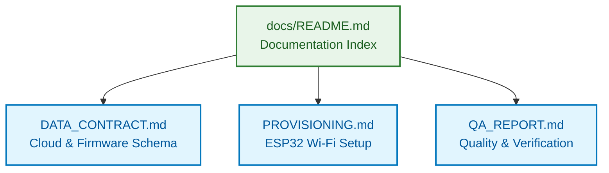

# Smart Medicine Box — Technical Documentation Index

Welcome to the engineering documentation for the **Smart Medicine Box** ecosystem. This directory contains architectural specifications, communication protocols, hardware provisioning guidelines, and quality assurance audit reports.

---

## Documentation Map

---

## Document Summaries

### 1. [Cloud Data Contract & Hardware Schemas (`DATA_CONTRACT.md`)](DATA_CONTRACT.md)
- **Scope**: Defines the contract between the ESP32 hardware firmware and the Android companion app.
- **Key Sections**:
  - **Firestore Path Tree**: Document hierarchies for `/users/{uid}/devices/{deviceId}`, telemetry singletons, and event queues.
  - **Hardware Telemetry Schema**: Real-time load cell grams, reed switch state, DHT22 temperature and humidity.
  - **Hardware Events Schema**: Discrete state transitions (`BOX_OPENED`, `BOX_CLOSED`, `WEIGHT_DROP`, `TAMPER_ALERT`).
  - **Remote Command Protocol**: Remote actuator controls including buzzer muting and force sync.
  - **Data Lifecycle Flowchart**: End-to-end telemetry sync from sensor read to UI recomposition.

### 2. [ESP32 Wi-Fi Provisioning Protocol (`PROVISIONING.md`)](PROVISIONING.md)
- **Scope**: Wi-Fi onboarding and setup mechanisms for connecting a new Smart Medicine Box to home networks.
- **Key Sections**:
  - **Provisioning Schemes**: SoftAP (HTTP Captive Portal) vs BLE (GATT Custom Transport).
  - **End-to-End Handshake Flowchart**: Step-by-step connection, scanning, credential transfer, and verification.
  - **Cryptographic Security**: Curve25519 Key Exchange, AES-256-GCM encryption, and Proof-of-Possession (POP) token authentication.
  - **Android Architecture**: Clean separation between `WifiProvisioningService` abstraction and hardware transports.

### 3. [Quality Assurance & Verification Report (`QA_REPORT.md`)](QA_REPORT.md)
- **Scope**: Comprehensive quality, stability, and compliance audit before v1.0.0 release.
- **Key Sections**:
  - **Test Suite Results**: 100% pass rate across 155 unit tests using `Turbine` and `kotlinx-coroutines-test`.
  - **Static Analysis & Linting**: Zero Detekt code-smell warnings and clean KtLint conformance.
  - **Memory & Resource Profiling**: LeakCanary 2.14 memory leak inspection and Android StrictMode audits.
  - **Process Death & Restoration**: Verification of ViewModel StateFlow persistence across process termination and configuration changes.
  - **Accessibility Conformance**: 48dp minimum touch target validation, WCAG AA color contrast compliance, and TalkBack screen-reader semantics.

---

## Quick Reference Table

| Document | Primary Audience | Key Technologies | Status |
| :--- | :--- | :--- | :--- |
| **[DATA_CONTRACT.md](DATA_CONTRACT.md)** | Firmware & Cloud Engineers | Cloud Firestore, JSON, MQTT/HTTP | **Active (v1.0)** |
| **[PROVISIONING.md](PROVISIONING.md)** | Embedded & Mobile Engineers | BLE GATT, SoftAP, Curve25519, AES-GCM | **Active (v1.0)** |
| **[QA_REPORT.md](QA_REPORT.md)** | QA, Android Engineers & Clinicians | JUnit 4, Turbine, LeakCanary, StrictMode | **Verified** |

