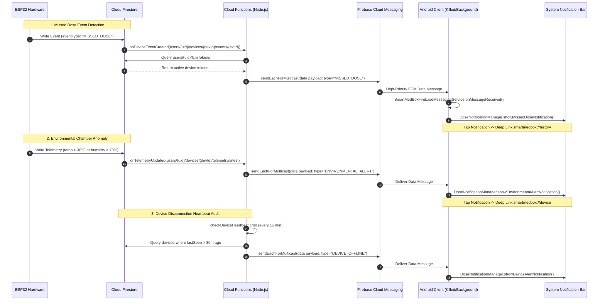

# Cloud Functions & Push Notification Architecture

This directory houses the backend serverless Cloud Functions for the **Smart Medicine Box** ecosystem, triggering remote push notifications via Firebase Cloud Messaging (FCM) when hardware events, environmental anomalies, or timeout conditions occur.

---

## 1. End-to-End Push Notification Flowchart



---

## 2. Event Triggers Specification

### 2.1 `onDeviceEventCreated`
- **Path**: `users/{userId}/devices/{deviceId}/events/{eventId}`
- **Trigger**: `onDocumentCreated`
- **Behavior**:
  - Checks if `eventType == "MISSED_DOSE"` or `status == "MISSED"`.
  - Queries active tokens from `users/{userId}/fcmTokens`.
  - Dispatches FCM data message with deep link `smartmedbox://history`.
  - Automatically deletes stale or unregistered tokens (`messaging/registration-token-not-registered`).

### 2.2 `onTelemetryUpdated`
- **Path**: `users/{userId}/devices/{deviceId}/telemetry/latest`
- **Trigger**: `onDocumentWritten`
- **Behavior**:
  - Analyzes DHT22 `temp` and `humidity` vitals.
  - Generates alert if `temp > 30°C` or `< 10°C`, or `humidity > 70%`.
  - Dispatches FCM data message with deep link `smartmedbox://device`.

### 2.3 `checkDeviceHeartbeat`
- **Trigger**: `onSchedule("every 15 minutes")`
- **Behavior**:
  - Scans paired devices.
  - If `now - lastSeen > 30 minutes` and `isOnline == true`, sets `isOnline = false`.
  - Dispatches FCM data message with deep link `smartmedbox://device`.

---

## 3. FCM Data Message Payloads

All FCM pushes are sent as pure **data messages** (`android: { priority: "high" }`) ensuring immediate execution in `SmartMedBoxFirebaseMessagingService.onMessageReceived()` whether the app is in the foreground, background, or killed state.

| Type | Key Fields | Deep Link Target |
| :--- | :--- | :--- |
| `DOSE_REMINDER` | `scheduleId`, `medicineName`, `dosage`, `repeatCount`, `gracePeriodMinutes` | `smartmedbox://schedule` |
| `MISSED_DOSE` | `scheduleId`, `medicineName`, `dosage`, `deviceId` | `smartmedbox://history` |
| `DEVICE_OFFLINE` | `deviceId`, `offlineMinutes`, `title`, `message` | `smartmedbox://device` |
| `ENVIRONMENTAL_ALERT` | `title`, `message`, `temp`, `humidity`, `deviceId` | `smartmedbox://device` |
| `LOW_STOCK` | `medicineName`, `remaining` | `smartmedbox://medicines` |

---

## 4. Local Emulation & Deployment

### Run Locally with Firebase Emulators
```bash
npm install
npm run serve
```

### Deploy to Firebase
```bash
firebase deploy --only functions
```

